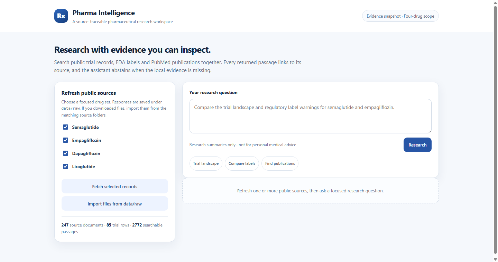
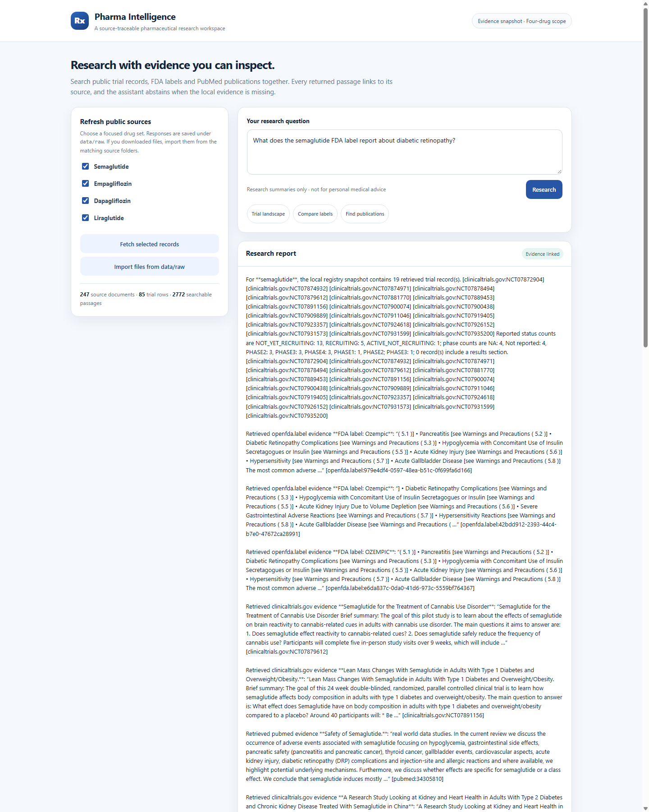

# Pharma Intelligence & Evidence-Based Research Agent

A focused, runnable research assistant for four medicines: semaglutide, empagliflozin, dapagliflozin, and liraglutide. It retrieves current public trial records, FDA product labels, and PubMed publications; stores a local snapshot; supports read-only trial queries; and returns source-linked evidence with limitations.

## Screenshots

The overview shows the local evidence counts. The example report was generated with the question: “What does the semaglutide FDA label report about diabetic retinopathy?”

### Dashboard overview



### Example research output



## Run locally

Requires Python 3.11 or newer.

```powershell
python -m venv .venv
.venv\Scripts\Activate.ps1
python -m pip install -e ".[dev]"
python -m pharma_intelligence.cli serve
```

Open http://127.0.0.1:8000, choose the medicines to include, and select **Fetch selected records**. The app saves source responses under `data/raw/` and writes normalized documents, chunks, and trial rows into `data/pharma_intelligence.sqlite3`. The database can be rebuilt by deleting that local database and refreshing again.

Useful commands:

```powershell
python -m pharma_intelligence.cli ingest --drug semaglutide
python -m pharma_intelligence.cli import-raw --drug semaglutide
python -m pharma_intelligence.cli status
python -m pharma_intelligence.cli ask "Compare trial phases for semaglutide and empagliflozin"
python -m pharma_intelligence.evaluation.run_retrieval
pytest -q --basetemp=data/test-temp
```

`PHARMA_DB_PATH`, `PHARMA_REQUEST_TIMEOUT`, `PHARMA_MAX_RESULTS`, `PHARMA_VECTOR_MODE`, `PHARMA_EMBEDDING_MODEL`, `NCBI_EMAIL`, `NCBI_API_KEY`, and `OPENFDA_API_KEY` are optional environment settings. A smaller `PHARMA_MAX_RESULTS` makes the first refresh faster. No API key is required for ordinary low-volume public-source use.

## Public data sources

There is no single bundled dataset. The project pulls a bounded query for the selected drug names from these public services:

- [ClinicalTrials.gov API v2](https://clinicaltrials.gov/data-api/api), with structured study status, phases, conditions, interventions, and results sections. [Example semaglutide query](https://clinicaltrials.gov/api/v2/studies?format=json&query.intr=semaglutide&pageSize=100).
- [openFDA drug label endpoint](https://open.fda.gov/apis/drug/label/), for product-label sections such as boxed warnings, warnings, contraindications, and adverse reactions. [Example semaglutide query](https://api.fda.gov/drug/label.json?search=openfda.generic_name%3A%22semaglutide%22&limit=100).
- [NCBI E-utilities](https://www.ncbi.nlm.nih.gov/books/NBK25500/), using PubMed ESearch followed by EFetch to retrieve bibliographic details and available abstracts. [Example PubMed search](https://pubmed.ncbi.nlm.nih.gov/?term=semaglutide%5BTitle%2FAbstract%5D).

The refresh uses the live APIs directly. If you prefer to download records yourself, save raw source responses with these names or any name containing the drug slug:

| Source | File to place under `data/raw/` | Expected contents |
|---|---|---|
| ClinicalTrials.gov | `clinicaltrials-gov/20261110_semaglutide.json` | API v2 JSON response containing `studies` |
| openFDA label | `openfda-label/20261110_semaglutide.json` | Label JSON response containing `results` |
| PubMed | `pubmed/20261110_semaglutide_efetch.xml` | EFetch XML containing `PubmedArticle` records |

The date in these example filenames is illustrative. Keep original JSON or XML response bodies; do not rename the source folders. In the interface, choose **Import files from data/raw**, or run `python -m pharma_intelligence.cli import-raw`. For PubMed, ESearch returns record IDs only; save EFetch XML for document import. Small local snapshots are appropriate here; the full openFDA or PubMed collections are not.

## How the system works

1. Source clients call the official public APIs with bounded result limits and request timeouts. A failure at one source is recorded without preventing other source refreshes.
2. Raw response snapshots are preserved in `data/raw/`; normalized documents and trial fields are upserted by stable source IDs into SQLite.
3. Documents are cleaned and split into overlapping word-boundary chunks. Retrieval can compare BM25, TF-IDF vector cosine search, and reciprocal-rank-fusion hybrid search followed by a transparent lexical reranker. An optional Sentence Transformers dense retriever can be selected for semantic vectors.
4. A controlled orchestrator routes trial counts and status breakdowns to a fixed, parameterized SQL agent and text evidence to the hybrid retrieval agent.
5. The synthesizer builds a deterministic report from stored fields and retrieved excerpts. The citation validator checks source IDs and official source hosts. A phrase screen can flag possible differences for human review, but does not decide whether findings truly conflict.

The local demo uses SQLite so it runs without a database server. A matching PostgreSQL DDL reference is in [docs/postgres_schema.sql](docs/postgres_schema.sql); the Python adapter in this demo is SQLite-only. Structured queries use parameterized values and a SQLite authorizer that denies writes. The application does not execute SQL generated from user text.

The synthesis stage is deterministic and does not call an LLM. By default, TF-IDF vector search is a reproducible lexical baseline; it will not match semantic retrieval from a trained embedding model. To enable dense semantic vectors, install `python -m pip install -e ".[semantic]"`, then set `PHARMA_VECTOR_MODE=sentence-transformer`. The default model is `sentence-transformers/all-MiniLM-L6-v2`; it downloads on first use and can be changed with `PHARMA_EMBEDDING_MODEL`. The system does not provide personal treatment guidance. Adverse-event reports are not ingested in this scope; label warnings and spontaneous reports are distinct evidence types, and an adverse-event report alone would not establish causation.

## Evaluation and safety

`data/processed/gold_queries.jsonl` has 40 source-level retrieval judgments tied to four known clinical trial records and their PubMed publications. The query set is a manually curated starting point, not a release-grade benchmark; details and verification links are in [docs/evaluation_dataset.md](docs/evaluation_dataset.md). The evaluation command reports Recall@5, Precision@5, MRR, and nDCG@5 for BM25, TF-IDF vectors, and hybrid plus reranking.

The test suite covers API timeout/error paths, absent source fields, duplicate upserts, metadata validation, chunk boundaries, empty retrieval, ranking metrics, bad citation references, read-only SQL enforcement and bound parameters, instruction-like retrieved text, unsupported questions, personal-medical-advice abstention, and the 40-query data file.

## Project layout

```text
data/raw/                 Original source API responses
data/processed/           Gold retrieval judgments
dashboard/                Local browser interface
docs/                     Evaluation notes and PostgreSQL DDL
src/pharma_intelligence/  Ingestion, processing, database, retrieval, agents, evaluation, safety
tests/                    Safety and component tests
```
